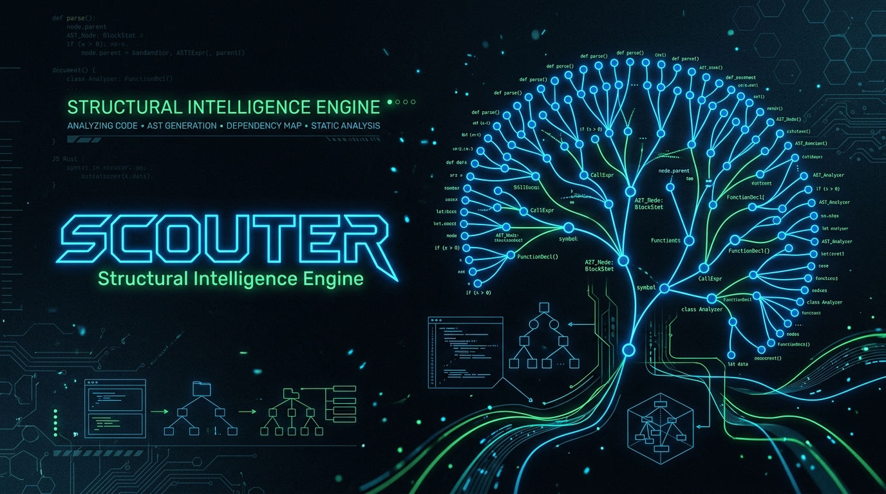

<p align="center">
  
</p>

# Scouter: Structural Intelligence Engine

[](https://github.com/Rogercode97/scouter/actions/workflows/ci.yml) [](https://github.com/Rogercode97/scouter/releases)

**Structural Analysis & Reconnaissance for AI Agents**
Deep AST inspection, impact analysis, and staged mutation with per-file atomic apply.

## Measured, not promised

Same question (`IndexerPipeline`) on this repository, Scouter vs ripgrep — procedure in [`docs/benchmarks/results.md`](docs/benchmarks/results.md), reproducible with `just bench`:

| Measurement | Scouter | ripgrep |
| --- | --- | --- |
| Answer size | **863 B (215 tokens)** | 2,572 B (643 tokens) |
| Query latency | 48 ms | **6 ms** |
| Index cost (one time, 252 files) | 12.6 s / 14.9 MB | — |

Scouter is slower per query and its answer is a third of the text — because the text baseline matches every line that merely names the query (docs included: it grew to 3,946 B when this benchmark landed) while Scouter resolves the same 8 symbols every run. Read the [30-second demo](docs/demo.md) to see it on this repo.

Scouter is the tactical visor for your AI coding agents. While memory systems provide context, Scouter provides the structural eyes. Instead of parsing plain text, Scouter parses and navigates the Abstract Syntax Tree (AST), bringing precision to autonomous code operations.

## Overview

Scouter is a high-performance, CGO-free, **single-binary CLI engine**. It parses Go with the standard library AST and other languages with Tree-sitter, indexes structures into SQLite (`modernc.org/sqlite` with `sqlite-vec` embeddings), and answers structural questions on demand: blast radius, symbol centrality, git churn risk, and staged multi-file mutation through a Staging Ledger.

It runs strictly as an **on-demand CLI**: no background daemons, no file watchers. This keeps memory flat and preserves inotify handles across environments. Complementing it, [CodeGraph](https://github.com/colbymchenry/codegraph) acts as the fast knowledge-graph reader for symbol exploration.

A Model Context Protocol server is also shipped for agents that prefer a tool-call surface over shelling out. The CLI remains the primary and fully supported interface.

### Core Capabilities

- **AST Mapping & Inspection**: Surgical analysis with `context` (token-dense architectural packet for a file), `neighborhood` (1-hop structural surroundings), and `twins` (logical duplication).
- **Impact Analysis (Blast Radius)**: Calculate exactly which files and symbols will break before modifying code with `impact` and `predict`.
- **Symbol Centrality**: Rank symbols by reference centrality with `critical`, and export the call graph as Mermaid with `graph`.
- **Safe Mutation (The Ledger)**: Every mutation is staged in the Ledger, persisted with the original content of each file, and diffed before it reaches disk via `diff`, `commit`, and `rollback`.
- **Diagnostic & Healing**: `audit`, `fix`, and `flow` drive root-cause analysis and closed-loop repair.

## Installation

```bash
go install github.com/Rogercode97/scouter/cmd/scouter@latest
```

## Agent Integration

Scouter can inject its MCP configuration directly into an agent's settings:

```bash
scouter setup <agent>
```

| Agent | Command |
| --- | --- |
| Gemini CLI | `scouter setup gemini-cli` |
| Antigravity CLI | `scouter setup antigravity-cli` |
| OpenCode | `scouter setup opencode` |
| Codex | `scouter setup codex` |
| Cursor | `scouter setup cursor` |
| Windsurf | `scouter setup windsurf` |
| Claude Code | `scouter setup claude` |

*(For full manual configuration and advanced options, see the [Agent Setup Guide](docs/tutorials/AGENT-SETUP.md))*

## Usage Guide

### Command Line Interface

The CLI is the primary surface. All commands are fast, on-demand, and safe to invoke per call.

```bash
# Health first: ast-grep, database, ledger (report-only, exit 1 on failure)
scouter doctor

# Map the codebase and index AST symbols
scouter index .

# Token-dense architectural context for one file: LOC, symbols, risk, churn, edit cost
scouter context internal/engine/analyzer.go

# 1-hop structural neighborhood of a file
scouter neighborhood internal/engine/analyzer.go

# Call graph for one symbol, exported as Mermaid (callers + callees)
scouter graph GetNeighborhood

# Highest-centrality symbols (hotspots)
scouter critical 20

# Blast radius before touching a symbol (short names resolve when unambiguous)
scouter impact SafeCommand internal/utils/safe_exec.go

# Predict affected tests from the current git diff
scouter predict

# Stage a rename across its blast radius, review, then apply atomically (or roll back)
scouter propagate 'github.com/Rogercode97/scouter/internal/utils.SafeCommand' 'rename:SafeCommand2'
scouter diff
scouter commit
scouter rollback

# Map runtime telemetry to AST symbols
cat telemetry.jsonl | scouter ingest --env production
```

Add the global `-u` / `--ultra-compact` flag to maximize context efficiency when piping output into an agent:

```bash
scouter -u context internal/engine/analyzer.go
```

### Model Context Protocol (Reference)

For agents wired through `scouter setup`, the MCP server exposes 29 tools grouped by objective, plus 4 prompts. The names below are the MCP surface; the CLI commands above are the equivalent on-demand surface. The specialized architectural and healing tools become available after `scouter_unlock`.

**Mapping and Verification**
- `ast_map`: Map a file or directory to return its skeleton (signatures without bodies).
- `ast_index`: Index a file or directory for AST symbols.
- `ast_snapshot` / `ast_verify`: Take snapshots to guarantee structural integrity pre and post-edit.

**Navigation and Intelligence**
- `ast_search`: Semantic or text search for symbols.
- `ast_read`: Read specific symbols or fragments.
- `ast_callers`: Trace call hierarchy.
- `ast_definition`: LSP-powered go-to-definition.
- `ast_type_info`: Type information for a symbol.
- `ast_neighborhood`: Get 1-hop structural neighborhood in ZON format.
- `ast_structural_search` / `ast_provenance`: Structural pattern matching and change provenance.

**Risk and Predictive Analytics**
- `risk_impact`: Calculate the blast radius of a change.
- `risk_predict`: Identify tests affected by current changes.
- `risk_critical_code`: Identify high-risk symbols based on high centrality and fragility.
- `risk_lint_architecture` / `risk_semantic_diff`: Architectural lint and semantic diffing.

**Safe Mutation (The Ledger)**
- `ledger_diff`: Review staged changes.
- `ledger_commit`: Commit staged changes to disk. Each file is replaced atomically; a failure mid-batch rolls the whole batch back in-process.
- `ledger_rollback`: Clear the staging area. It does not revert files already written to disk.
- `ledger_ripple`: Rename or change signatures across the codebase, staged as a single Ledger commit.
- `ledger_evolve`: Apply multi-file architectural changes through the Ledger.

**Cognitive & Diagnostic Engines**
- `scouter_diagnose`: Generate a Diagnostic HUD from error logs.
- `scouter_heal`: Execute a full RCA, fix, and verify loop for tests.
- `cognitive_dream`: Distill Architectural Decision Records (ADRs) and pattern summaries.
- `cognitive_anchor` / `cognitive_obsidian` / `cognitive_signal`: Context anchoring and signal extraction.
- `scouter_unlock`: Unlock the specialized architectural and healing tools. It does not recover an interrupted commit.

**Prompts**
- `cognitive_compact`: Compact a technical session into a dense summary.
- `gep_mutator`: System prompt for the Genome Mutator (GEP).
- `judge`: System prompt for the Cynical Adversarial Judge.

## Architecture

Scouter relies on a strict internal modular structure:

- `cmd/scouter/scoutercmd/`: The modular CLI command definitions (Cobra).
- `cmd/scouter/`: The application entry point (`main.go`).
- `internal/engine/`: The core analytical brains, handling search, impact, refactoring, and automated healing.
- `internal/store/`: The data persistence layer (pure-Go SQLite with FTS5 and vector extensions).
- `internal/mcp/`: The MCP server, handler logic, and tool registrations.
- `odd/tasks/`: Organic Driven Development feature documents (specs, tasks, evidence).

**Core Invariant**: Validation is finality. No destructive mutation is ever applied directly to disk: every change passes through the Staging Ledger first, where it can be diffed, inspected and rolled back. Impact analysis (`impact`, `risk_impact`) is a separate, advisory step — the commit path does not enforce it.

## Documentation Resources

- **Architecture Overview**: `docs/architecture/overview.md`
- **Analysis Limits and Guarantees**: `docs/architecture/analysis-limits.md`
- **Engine Internals**: `docs/architecture/engine.md`
- **Codebase Guide**: `docs/architecture/codebase.md`
- **MCP Reference**: `docs/reference/MCP-REFERENCE.md`
- **Decisions (ADRs)**: `docs/adr/`
- **Security Policy**: `SECURITY.md`
- **Contributing Guidelines**: `CONTRIBUTING.md`

## License

MIT License.
